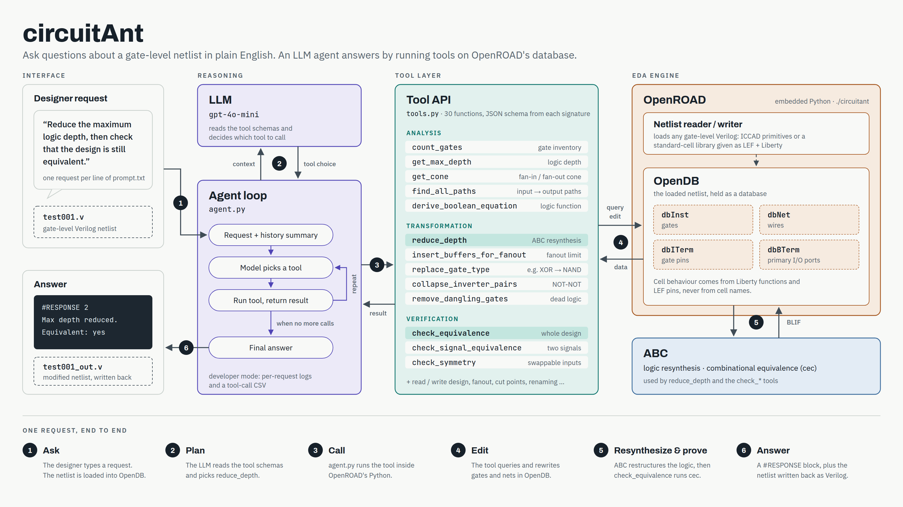

# circuitAnt: Circuit Analysis and Transformation using LLM-guided tool calls

An LLM agent that answers natural-language requests about gate-level Verilog
netlists — analysis ("what is the maximum logic depth?"), transformation
("replace every XOR with NAND gates") and verification ("is the design still
equivalent?") — by calling tools that run on OpenROAD's database (OpenDB) and
ABC.

How to change or extend the code, and the rules it follows: [DEVELOPING.md](DEVELOPING.md).

## How it works



* Each line of the prompt file is one request. The agent sends it to the model
  with a summary of the earlier requests; the model calls tools; the answer is
  printed as a `#RESPONSE n` block.
* A tool is a method of `Tools` in `tools.py`; its JSON schema is generated from
  the method's signature and docstring.
* The engine (`eda_engine/`) loads the netlist into OpenDB through OpenROAD and
  answers everything from it. Cells are understood from their libraries (LEF pins,
  Liberty functions), not from their names, so any standard-cell library works.
* Logic resynthesis and equivalence proofs use ABC; OpenROAD's own BLIF writer
  and reader move logic between OpenDB and ABC.

## Layout

```
circuitAnt/
├── circuitant              executable: runs main.py inside OpenROAD's Python
├── run.sh                  runs every testcase in a folder (like cada1067's run.sh)
├── openroad_python.sh      runs any Python script inside OpenROAD (test automation, scripts)
├── config.yaml             model, API key file, output folder, netlist format, developer mode
├── .env                    the OpenAI API key (never commit or share it)
├── main.py                 reads requests from stdin, prints responses, sets up logs
├── agent.py                the LLM loop: system prompt, history summaries, tool calls
├── tools.py                the tools offered to the model (one method each) + schema generator
├── eda_engine/             the netlist engine (no LLM code)
│   ├── design.py           Design: the loaded netlist (OpenDB block) + library cell table
│   ├── design_io.py        read_design / write_design: dispatch by format
│   ├── iccad/              the ICCAD primitive format
│   │   ├── reader.py       primitives -> standard cells, then the generic reader
│   │   ├── writer.py       standard cells -> primitives (exact ICCAD header)
│   │   └── cells/          primitives.lef / primitives.lib: the primitives as cells
│   ├── generic/            any flattened gate-level netlist with its own LEF/Liberty
│   │   ├── reader.py       OpenROAD read + link (top = the one module)
│   │   └── writer.py       OpenROAD write_verilog
│   ├── utils.py            shared netlist queries (reachability, cones, paths, views)
│   ├── edit.py             shared netlist edits (add/remove gates, merge nets, rename)
│   ├── blif.py             BLIF for ABC, and running ABC (equivalence proofs)
│   ├── analysis/           queries: inventory, depth, paths, cones, fanout, patterns, equations
│   ├── transformation/     edits: naming, cleanup, buffering, resynthesis
│   └── verification/       proofs: whole-design equivalence, signal equivalence, symmetry
├── docs/                   architecture.dot -> architecture.png (the diagram above)
├── debugging/
│   ├── developer.py        developer-mode logs and the per-run tool-call CSV
│   ├── README.md           what the files here are (predicted CSV = expectation, not ground truth)
│   ├── predicted_run_analysis.csv   which tool each testcase prompt is expected to need
│   ├── run_analysis_<run>.csv       which tools each request actually called (developer mode)
│   └── logs/<run>/         one folder per run: openroad.log + per-request logs
├── output/                 testcase logs, written netlists, long result lists
├── testcase/               testcases: testcase/<case>/{prompt.txt, <case>.v}
├── examples/               Nangate45 netlists (Synopsys DC) for the generic format
└── tests_automation/       test automation for the engine: test_engine.py + small test netlists
```

## Installation

circuitAnt runs inside OpenROAD's embedded Python, and calls the ABC binary.

**1. OpenROAD** (with its Python interface). Build it from
<https://github.com/The-OpenROAD-Project/OpenROAD> following its build guide. The
scripts look for it at `~/OpenROAD/build/bin/openroad`; if yours is elsewhere, set
`OPENROAD_BIN` (step 4).

**2. ABC.** Build it from <https://github.com/berkeley-abc/abc>:

```bash
git clone https://github.com/berkeley-abc/abc.git ~/abc && make -C ~/abc -j"$(nproc)"
```

The scripts look for it at `~/abc/abc`; if yours is elsewhere, set `ABC_BIN` (step 4).

**3. Python packages** ([requirements.txt](requirements.txt): `openai`, `pyyaml`). They must
go into the Python that OpenROAD embeds — the system Python 3, not a virtual
environment or a uv/conda Python, which OpenROAD would not see:

```bash
echo 'import sys; print(sys.prefix, sys.version.split()[0])' | ./openroad_python.sh /dev/stdin   # which Python OpenROAD uses (here: /usr 3.10.12)
/usr/bin/python3 -m pip install --user -r requirements.txt
```

**4. Tool paths** (only if OpenROAD or ABC are not at the default locations). Add to
`~/.bashrc` or `~/.zshrc`:

```bash
export OPENROAD_BIN=/path/to/OpenROAD/build/bin/openroad
export ABC_BIN=/path/to/abc/abc
```

`circuitant`, `run.sh` and `openroad_python.sh` read these (falling back to the default
locations above) and fail with `missing <path>` if OpenROAD is not found.

**5. The OpenAI API key** (below), then check the installation:

```bash
./openroad_python.sh tests_automation/test_engine.py     # engine + OpenROAD + ABC: prints OK
./circuitant -config config.yaml <<< "This is the beginning of a new testcase. The case name is check."   # + OpenAI
```

### Setting the API key

Put your OpenAI API key in `circuitAnt/.env` — the file named by
`openai: api_key_file` in `config.yaml` — as the **only** content of the file:

```bash
echo "sk-...your key..." > .env
chmod 600 .env          # readable only by you
```

The whole file is read as the key, so write just the key, not `OPENAI_API_KEY=sk-...`.
If that file doesn't exist, the key is taken from `openai: api_key` in `config.yaml` or
from the `OPENAI_API_KEY` environment variable. Never commit or share `.env`.

## Configuration (`config.yaml`)

Relative paths are relative to `config.yaml`.

| Key | Meaning |
|---|---|
| `openai.api_key_file`, `openai.model` | where the API key is read from; which chat model to use |
| `output_dir` | where `<case>.log`, written netlists and long result lists go (default here `./output`); leave it out to write them to the current directory |
| `design.format` | `iccad` (ICCAD gate-primitive netlists on the built-in cells) or `generic` |
| `design.lef`, `design.liberty` | generic only: the netlist's LEF files (technology LEF first) and Liberty files |
| `developer.mode` | `true`: per-request logs and the tool-call CSV are written |
| `developer.log_dir` | optional: put `logs/<run>/` somewhere else than `debugging/` |

A generic netlist must be **flattened** (a single module); that module is the
top. Example for Nangate45:

```yaml
design:
  format: generic
  lef: [/home/innocent/OpenROAD/test/Nangate45/Nangate45_tech.lef,
        /home/innocent/OpenROAD/test/Nangate45/Nangate45_stdcell.lef]
  liberty: [/home/innocent/OpenROAD/test/Nangate45/Nangate45_typ.lib]
```

## Commands (run from `circuitAnt/`)

**Run every testcase in a folder**

```bash
./run.sh testcase                    # or a full path: ./run.sh /path/to/testcase
```

Each `<folder>/<case>/prompt.txt` is run. Prompts name their files as
`testcase/<case>/...`, so each testcase runs from the folder's parent. Responses
are printed; `run.sh` reports how many testcases ran and where outputs and logs
went.

**Run one prompt file, or type requests**

```bash
./circuitant -config config.yaml < testcase/test003/prompt.txt
./circuitant -config config.yaml     # then type one request per line, Ctrl-D to end
```

**Run the test automation** (no LLM, about 20 s)

```bash
./openroad_python.sh tests_automation/test_engine.py
```

**Use the engine from a Python script** (must run inside OpenROAD)

```python
# my_script.py, run with: ./openroad_python.sh my_script.py
import sys; sys.path.insert(0, "/home/innocent/phd/postg/iccadtest/circuitAnt")
from eda_engine import read_design, analysis, transformation, verification

d = read_design("testcase/test003/test003.v")                     # ICCAD format
print(analysis.count_gates(d))
print(analysis.get_max_depth(d, "ANY_START", "ANY_END")["depth"])
transformation.reduce_depth(d)
print(verification.check_equivalence(d)["status"])

g = read_design("examples/dsp_circuit_1_16_bit_Nan45.v", format="generic",
                lef=[".../Nangate45_tech.lef", ".../Nangate45_stdcell.lef"],
                liberty=[".../Nangate45_typ.lib"])
print(analysis.find_gates(g, "NAND")["by_cell"])                   # NAND2_X1, NAND4_X1, ...
```

## Test automation (`tests_automation/`)

The engine has its own test automation platform: 77 automated tests that call the
engine functions directly — no LLM, no API calls — on small netlists and compare
the results with known answers. Run it before and after every change to the engine;
it prints `OK` or the failing tests, and leaves no files behind.

| Covers | How |
|---|---|
| Analysis: counts, depth, paths, cones, fanout, ports, patterns, equations | expected values, several from cada1067's engine on ICCAD test10 |
| Verification: equivalence, signal equivalence, symmetry | equivalent rewrites must PASS; deliberately broken designs must FAIL, with the right failing outputs |
| Transformations and resynthesis | each result checked for its purpose, then `check_equivalence` must PASS and the written netlist must read back |
| Reading and libraries | ICCAD pin order and flip-flop linking; the generic reader on Nangate45 (top module, ports, cell classification, escaped names, multi-output cells) |

The netlists in `tests_automation/` are small, mostly hand-written, each containing
the cases one group of tests needs (described in a comment at the top of each file),
plus a copy of ICCAD test10. The Nangate45 tests are skipped if the Nangate45 files
are not installed.

## What the agent can do (30 tools, in `tools.py`)

| Kind | Tools |
|---|---|
| Session | `set_testcase_name`, `read_design`, `write_design` |
| Inventory | `count_gates`, `find_gates` (by logic type such as NAND / AOI21 / FA, or cell-name pattern), `get_ports` |
| Depth and paths | `get_max_depth`, `get_endpoint_stats`, `find_all_paths`, `find_cut_points` |
| Cones and fanout | `get_cone`, `get_fanout` |
| Patterns | `find_inverter_pairs`, `find_duplicates`, `find_enable_hold`, `derive_boolean_equation` |
| Verification | `check_equivalence`, `check_signal_equivalence`, `check_symmetry` |
| Clean-up | `remove_dangling_gates`, `collapse_inverter_pairs`, `merge_duplicate_gates`, `simplify_gates_with_constant_inputs` |
| Naming | `rename_gate`, `rename_wire` |
| Buffering | `insert_buffers_for_fanout`, `insert_dedicated_buffers_for_loads` |
| Resynthesis (ABC) | `reduce_depth`, `remap_gates` (whole design or a cone onto a gate set), `replace_gate_type` |

Endpoint keywords for depth/path tools: `ANY_PI`, `ANY_DFF_Q`, `ANY_START`
(sources); `ANY_PO`, `ANY_DFF_D`, `ANY_END` (sinks). Flip-flops cut paths.

## Outputs and logs

| What | Where |
|---|---|
| Responses | stdout, and `output/<case>.log` (`#RESPONSE n ... #END n`) |
| Written netlists | `output/<path from the prompt>` (a full path is used as given) |
| Long result lists | `output/<case>_r<request>_<name>.txt`, e.g. `test097_r04_paths_ANY_DFF_Q_to_ANY_DFF_D.txt` |
| OpenROAD's messages | `debugging/logs/<run>/openroad.log` |
| Per-request logs (developer mode) | `debugging/logs/<run>/<case>_request_<n>_<time>.log`: prompt, context, every model turn, tool results |
| Tools actually called (developer mode) | `debugging/run_analysis_<run>.csv`, one row per request; compare with `predicted_run_analysis.csv` (an expectation, not ground truth — see [debugging/README.md](debugging/README.md)) |

A run is one `run.sh` invocation (all its testcases) or one direct `circuitant`
call; `<run>` is its start time, e.g. `20261010_190424`.

## Formats

* **iccad** — the contest netlists: Verilog primitives (`and g1(y, a, b);`,
  `dff`) and literal constants. The reader rewrites them into standard cells
  (`AND g1 (.Y(y), .A(a), .B(b));`, constants driven by `TIEHI`/`TIELO`) defined in
  `iccad/cells/`; the writer translates back and reproduces the original module
  header.
* **generic** — any flattened gate-level netlist OpenROAD can read with its LEF and
  Liberty, e.g. Synopsys DC output mapped to Nangate45 (`examples/`). Written back
  with OpenROAD's `write_verilog`.

## Semantic Plan Cache

circuitAnt includes an optional semantic plan cache ([plan_cache/](plan_cache/)) inspired by [Agentic Plan Caching](https://arxiv.org/abs/2506.14852). It generalizes and reuses tool-calling plans across similar requests and across unseen netlists without raw prompt/answer caching.

### Configuration (`config.yaml`)

```yaml
plan_cache:
  enabled: false                      # set true to activate plan caching
  path: output/plan_cache.sqlite      # SQLite database storing plan templates
  embedding_model: text-embedding-3-small
  similarity_threshold: 0.85          # cosine similarity threshold for template match
  max_failures_before_drop: 3         # drop templates failing execution/equivalence
```

### Key Principles
1. **Trace Recording**: After successful normal agent runs, records request, ordered tool calls, arguments, parsed results, and latency/token counts.
2. **Template Generalization**: Linear tool plans are converted into parameterized templates with typed slots (`<SIGNAL:0>`, `<GATE_TYPE:0>`, `<NUMBER:0>`) and inter-step dataflow references (`$step_k.result.<path>`). Non-linear traces (loops or per-item repetitions) are detected and excluded from the cache.
3. **Deterministic Matching & Validation**: Requires cosine similarity $\ge$ threshold, deterministic slot filling against the loaded OpenDB netlist, valid tool existence, and an opposite-word check (e.g. `max`/`min`, `fanin`/`fanout`, `count`/`list`).
4. **Transactional Execution & Fallback**: Mutating plans take a design snapshot before execution and verify equivalence with `check_equivalence()`. On any step failure or verification failure, the snapshot is automatically restored and the agent falls back to normal LLM execution.
5. **Evaluation**: Run `./openroad_python.sh eval/plan_cache_eval.py` to evaluate matching accuracy, token savings, latency reductions, and threshold sweeps.

